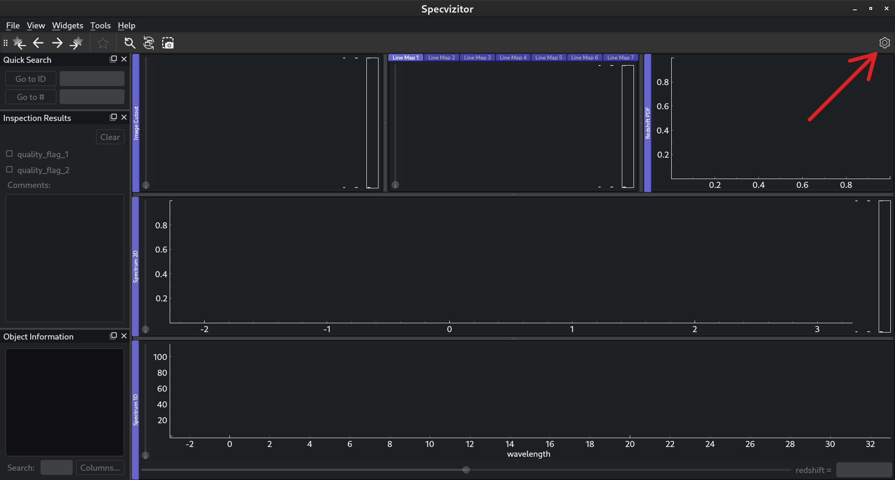
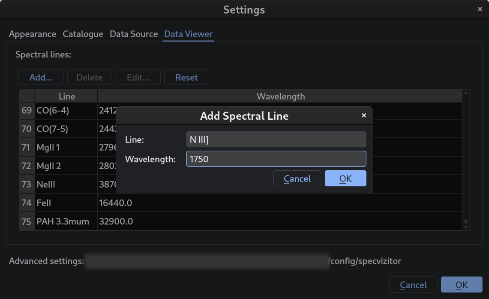
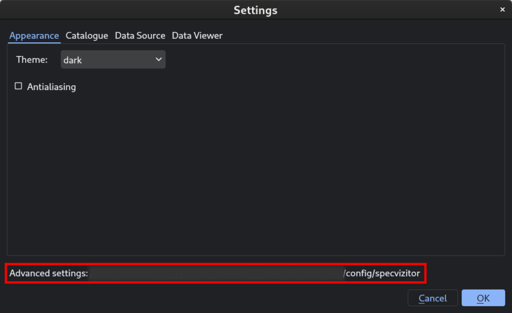

Application Settings
====================

Basic settings
++++++++++++++

Some basic settings such as the data path are available in :menuselection:`Tools --> Settings`. You can also access :guilabel:`Settings` by clicking on the cogwheel in :guilabel:`Toolbar`:

:guilabel:`Settings` include the following sections:

.. list-table::
    :header-rows: 1
    :widths: auto

    * - Section
      - Purpose(s)
      - Scope
    * - :guilabel:`Appearance`
      - Change the application theme, configure antialiasing [#f1]_, etc.
      - You
    * - :guilabel:`Catalog`
      - Load a new catalog, configure aliases for column names
      - Workspace
    * - :guilabel:`Data Source`
      - Change the data path, add new images, configure unit aliases
      - Workspace
    * - :guilabel:`Data Viewer`
      - Set the redshift steps and the default screenshot location, add spectral lines
      - You
    * - :guilabel:`Plugins`
      - Enable the plugins that adapt the data viewer to a dataset
      - Workspace

The :guilabel:`Scope` column says whether a setting follows *you* across every workspace or
belongs to the current workspace alone (see :doc:`workspaces`).

Most changes take effect immediately once you click :guilabel:`OK`. A few cannot, because they
are applied once while the application starts, and specvizitor will offer to restart:

.. list-table::
    :header-rows: 1
    :widths: auto

    * - Setting
      - Why a restart is needed
    * - Application theme
      - Applied as a stylesheet at startup
    * - Plugins
      - Imported at startup

Adding spectral lines
^^^^^^^^^^^^^^^^^^^^^

Open :guilabel:`Settings` ‣ :guilabel:`Data Viewer`. Click :guilabel:`Add...` and enter the line's name and wavelength:

Click :guilabel:`OK`. The new line should appear in the data viewer.

Advanced settings
+++++++++++++++++

Some settings, for example the widget configuration, cannot be modified from the GUI. These are
stored as `YAML <https://yaml.org>`_ files inside the current workspace. Click the directory
indicated at the bottom of :guilabel:`Settings` (under "Advanced settings") to open it in your
file manager:

The workspace contains the following files:

.. list-table::
    :header-rows: 1
    :widths: auto

    * - File
      - Description
      - Integrated in the GUI
    * - ``workspace.yml``
      - Paths to the data and the catalog, catalog settings, plugins, etc.
      - Yes
    * - ``data_widgets.yml``
      - Widget configurations
      - No
    * - ``layout.yml``
      - Window layout
      - Yes (implicitly)
    * - ``state.yml``
      - The inspection file you had open, and your position in it
      - Yes (implicitly)

Open one of these files in a text editor and make the desired changes.

.. tip::

    You do not have to restart specvizitor after editing ``data_widgets.yml``. Use
    :menuselection:`Widgets --> Restore...` and select the file you just edited: the new
    configuration is applied immediately.

.. note::

    If a ``*.yml`` file contains errors, specvizitor overwrites it at startup. The original file
    is kept in the same directory as ``*.yml.bak`` (e.g., ``workspace.yml.bak``).

Most of the parameters stored in these ``*.yml`` files can be modified directly from the GUI,
with the important exception of the widget configuration (``data_widgets.yml``). A comprehensive
guide on how to modify the ``data_widgets.yml`` file (add new widgets, configure existing ones)
can be found in the :doc:`data-viewer` section.

Your own preferences (e.g., the list of spectral lines) are not part of a workspace. They are
stored in the application configuration directory (on Linux, ``$HOME/.config/specvizitor``) and
apply to every workspace.

.. rubric:: Footnotes

.. [#f1] Enabling antialiasing might decrease the GUI responsiveness.
